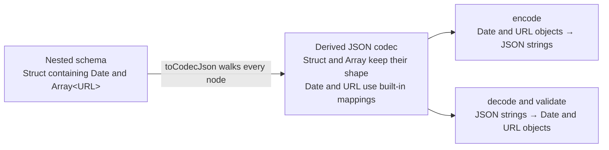

A schema describes a domain value and the input that decodes into it. Sometimes
you need another representation of the same value, such as JSON for an API or a
tree of strings for a form.

A canonical codec derives that representation from the schema. The derived
codec keeps the original decoded `Type` and gives it a format-specific encoded
side.

| Function                   | Encoded representation | Typical use                                |
| -------------------------- | ---------------------- | ------------------------------------------ |
| `Schema.toCodecJson`       | `Schema.Json`          | JSON-compatible data                       |
| `Schema.toCodecStringTree` | `Schema.StringTree`    | Query parameters, forms, and configuration |
| `Schema.toCodecIso`        | The schema's `Iso`     | Optics and reusable transformations        |

Derivation builds a new codec. It does not encode or decode a value by itself.
Pass the result to the usual Schema parsing functions, such as
`Schema.encodeSync` or `Schema.decodeUnknownSync`.

## JSON

`Schema.toCodecJson` derives a codec whose encoded side contains only JSON
values. Effect walks nested structs, tuples, arrays, unions, and suspended
schemas. Built-in schemas define representations for values such as `Date`,
`URL`, `Option`, and `BigInt`.



Built-in schemas provide these mappings. For custom declarations that need a
JSON conversion, define a `toCodecJson` or `toCodec` annotation, as described
below.

**Example** (Deriving JSON for a Nested Schema)

```ts twoslash import.meta.vitest name="canonical-codecs-json-1"
import { Schema } from "effect"

const Event = Schema.Struct({
  createdAt: Schema.Date,
  links: Schema.Array(Schema.URL),
})

const JsonEvent = Schema.toCodecJson(Event)

const encoded = Schema.encodeSync(JsonEvent)({
  createdAt: new Date("2025-01-01T00:00:00.000Z"),
  links: [new URL("https://effect.website/docs/")],
})

encoded // => { createdAt: "2025-01-01T00:00:00.000Z", links: ["https://effect.website/docs/"] }

const decoded = Schema.decodeUnknownSync(JsonEvent)(encoded)
decoded.createdAt instanceof Date // => true
decoded.links[0] instanceof URL // => true
```

The traversal respects an explicit encoding already present in the schema. For
example, if a `Date` first encodes to epoch milliseconds, the JSON codec keeps
that number representation instead of replacing it with the built-in ISO date
string.

## StringTree

`Schema.toCodecStringTree` preserves arrays and objects but converts their leaf
values to strings. Its encoded type is:

```ts showLineNumbers=false
type StringTree =
  | string
  | undefined
  | { readonly [key: string]: StringTree }
  | ReadonlyArray<StringTree>
```

**Example** (Encoding Structured Values as Strings)

```ts twoslash import.meta.vitest name="canonical-codecs-string-tree-1"
import { Schema } from "effect"

const Search = Schema.Struct({
  page: Schema.Int,
  exact: Schema.Boolean,
  tags: Schema.Array(Schema.String),
})

const StringTreeSearch = Schema.toCodecStringTree(Search)

Schema.encodeSync(StringTreeSearch)({
  page: 2,
  exact: true,
  tags: ["schema", "effect"],
}) // => { page: "2", exact: "true", tags: ["schema", "effect"] }

Schema.decodeUnknownSync(StringTreeSearch)({
  page: "2",
  exact: "true",
  tags: ["schema", "effect"],
}) // => { page: 2, exact: true, tags: ["schema", "effect"] }
```

Query parameters and form data are common uses for this representation because
they encode numbers and booleans as strings.

## Iso

`Schema.toCodecIso` derives a codec between a schema's decoded `Type` and its
`Iso` representation. The `Optic.ts` module performs structural updates on
plain JavaScript objects and arrays. The codec converts other data types to one
of those shapes before an optic traverses or updates them, then converts the
result back. For example, a class schema's `Iso` is a plain object containing
the class fields.

**Example** (Converting a Class to Its Iso Representation)

```ts twoslash import.meta.vitest name="canonical-codecs-iso-1"
import { Schema } from "effect"

class Person extends Schema.Class<Person>("Person")({
  name: Schema.String,
  age: Schema.Number,
}) {}

const PersonIso = Schema.toCodecIso(Person)
const person = new Person({ name: "Ada", age: 36 })

const encoded = Schema.encodeSync(PersonIso)(person)
encoded // => { name: "Ada", age: 36 }

Schema.decodeUnknownSync(PersonIso)(encoded) instanceof Person // => true
```

## Custom declarations

Declarations are opaque to the recursive traversal. Add a codec annotation to
tell Effect which structural representation to use.

| Derivation | Annotation lookup order                                 | If no annotation applies                              |
| ---------- | ------------------------------------------------------- | ----------------------------------------------------- |
| JSON       | `toCodecJson`, then `toCodec`                           | Uses `Schema.Json`; parsing the declaration may fail  |
| StringTree | `toCodecStringTree`, then `toCodecJson`, then `toCodec` | Derivation throws because it lacks a structural codec |
| Iso        | `toCodecIso`, then `toCodec`                            | Keeps the declaration's own representation            |

Use a format-specific annotation when formats need different representations.
Use `toCodec` for a representation shared by every derivation. A
`toCodecJson` or `toCodecStringTree` callback may return `undefined` to mark the
declaration as already canonical for that format.

The next example gives `Point` a JSON tuple representation. StringTree
derivation can reuse that JSON link, then recursively convert the numbers to
strings.

**Example** (Defining a Representation for a Declaration)

```ts twoslash import.meta.vitest name="canonical-codecs-declaration-1"
import { Schema, SchemaTransformation } from "effect"

class Point {
  constructor(
    readonly x: number,
    readonly y: number,
  ) {}
}

const PointSchema = Schema.instanceOf(Point, {
  toCodecJson: () =>
    Schema.link<Point>()(
      Schema.Tuple([Schema.Finite, Schema.Finite]),
      SchemaTransformation.transform({
        decode: ([x, y]) => new Point(x, y),
        encode: (point) => [point.x, point.y] as const,
      }),
    ),
})

const point = new Point(1, 2)

Schema.encodeSync(Schema.toCodecJson(PointSchema))(point) // => [1, 2]
Schema.encodeSync(Schema.toCodecStringTree(PointSchema))(point) // => ["1", "2"]
```

Codec annotations may contain fallible or effectful transformations. The parser
used to consume the derived codec controls their execution and failure handling.
`Schema.toIso` consumes `toCodecIso` synchronously, so transformations used
through that API must complete synchronously. An annotation cannot add a
required service that is absent from the derived codec's service type.

## Relationship to JSON Schema

`Schema.toJsonSchemaDocument(schema)` first derives the canonical JSON codec,
then describes its encoded side. A custom `toCodecJson` annotation therefore
defines both the runtime JSON representation and the shape emitted as JSON
Schema.

For the `PointSchema` above, JSON Schema generation describes a two-item array
of numbers. An opaque declaration without a structural JSON codec produces an
unconstrained JSON Schema instead. See [JSON Schema](/docs/v4/schema/json-schema)
for generation options and limitations.
