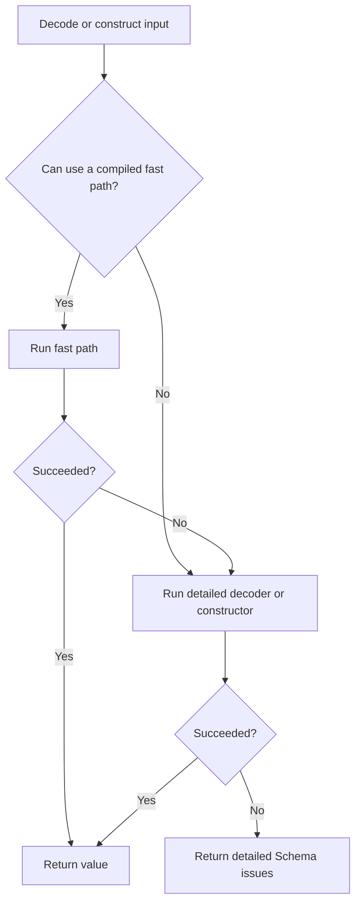

import { Aside } from "@astrojs/starlight/components"

Effect normally interprets a Schema's AST when it decodes, encodes, validates,
or constructs a value. The Schema compilers generate JavaScript for supported
parts of that AST and install it in the parser's registry. Your application
continues to call the usual `Schema` APIs.

Compilation is an optimization. It does not change the `Schema` APIs or their
results. Unsupported nodes still use the interpreter.

<Aside type="caution" title="Unstable API">
  The Schema compiler modules are experimental. Their APIs and generated output
  may change between releases. Measure them against your own schemas before
  enabling them in production.
</Aside>

## How the fast path works

Decoding and construction may start with a synchronous fast path. If it
succeeds, Effect returns the value immediately. If it fails, Effect runs the
detailed decoder or constructor to produce the usual Schema issues.

A fast path is available only when both conditions are met:

- A compiler is active for that AST and operation before the application creates
  or runs the parser. This means enabling JIT or loading an AOT module that
  includes the operation.
- The compiler supports the schema and can run the operation safely. It skips
  fast paths that could repeat defaults, class constructors, transformations,
  middleware, or other effects.



The second pass means checks and property getters may run twice for invalid
input. When a compiled `Schema.is` guard is available, it returns `false`
directly because callers do not need error details.

## Choosing a compiler

Effect has two compiler modes:

| Mode | When code is generated                      | Main tradeoff                                                                                                                |
| ---- | ------------------------------------------- | ---------------------------------------------------------------------------------------------------------------------------- |
| JIT  | At runtime, when an operation is first used | Requires dynamic function construction but needs no build step.                                                              |
| AOT  | During a build step                         | Produces a static module for environments that block `new Function`, but the module must be regenerated when schemas change. |

Both modes use the same source generator and parser registry. They can compile
only the operations you use, while the interpreter handles the rest.

## Just-in-time compilation

The quickest way to enable JIT compilation is a side-effect import in your
application entry point:

```ts showLineNumbers=false
import "effect/schema/SchemaJITCompiler/enable"
```

Place this import before code that creates or runs Schema parsers. Importing
`SchemaJITCompiler` from the `effect/schema` barrel does not enable compilation
by itself.

Once enabled, existing Schema code needs no changes:

**Example** (Enabling JIT Compilation Globally)

```ts twoslash import.meta.vitest name="schema-compiler-jit-global-1"
import "effect/schema/SchemaJITCompiler/enable"
import { Schema } from "effect"

const User = Schema.Struct({
  id: Schema.Number,
  name: Schema.String,
})

const decode = Schema.decodeUnknownSync(User)

decode({ id: 1, name: "Ada" }) // => { id: 1, name: "Ada" }
```

Operations compile lazily on first use. Merely importing the enable module does
not walk every schema or run checks, transformations, or defaults.

### Enabling one schema

Use `SchemaJITCompiler.enable` when only selected schemas should use JIT
compilation:

**Example** (Enabling JIT Compilation for One Schema)

```ts twoslash import.meta.vitest name="schema-compiler-jit-one-schema-1"
import { Schema } from "effect"
import { SchemaJITCompiler } from "effect/schema"

const User = Schema.Struct({
  id: Schema.Number,
  name: Schema.String,
})

SchemaJITCompiler.enable(User.ast)

Schema.decodeUnknownSync(User)({ id: 1, name: "Ada" }) // => { id: 1, name: "Ada" }
```

This enables the exact AST passed to `enable` and the dependencies reached
while parsing it. Decoding, encoding, guards, and construction can use different
AST roots. Enable those roots separately when you need them:

```ts twoslash import.meta.vitest name="schema-compiler-jit-directions-1"
import { Schema, SchemaAST } from "effect"
import { SchemaJITCompiler } from "effect/schema"

const Port = Schema.FiniteFromString

// Decode a string to a number.
SchemaJITCompiler.enable(Port.ast)

// Validate or construct the decoded number.
SchemaJITCompiler.enable(SchemaAST.toType(Port.ast))

// Encode a number to a string.
SchemaJITCompiler.enable(SchemaAST.flip(Port.ast))
```

The global side-effect import handles these roots as parser operations reach
them, so this distinction matters mainly when using selective JIT or the
low-level AOT API.

### JIT fallback

JIT compilation uses `new Function`. If the runtime's Content Security Policy
or JavaScript engine blocks dynamic function construction, Effect keeps the
interpreted parser. It also falls back when source generation or compiler
initialization fails.

Exceptions thrown while an already compiled parser is running are ordinary
parser exceptions. Effect does not treat them as compiler failures or retry
them with the interpreter.

## Ahead-of-time compilation

AOT compilation writes the generated parser code to an ES module during a
build. The generated module does not import the source generator and does not
use `new Function`.

For application builds, use `SchemaAOTCompilerBuild.build`. It finds Schema
values directly exported by the modules you list and writes a self-installing
module.

**Example** (Generating an AOT Module)

```ts title="build-schema-aot.ts"
import { Effect } from "effect"
import { NodeFileSystem, NodePath } from "@effect/platform-node"
import * as SchemaAOTCompilerBuild from "effect/schema/SchemaAOTCompiler/Build"

const build = SchemaAOTCompilerBuild.build({
  modules: {
    "./schemas/User.js": () => import("./schemas/User.js"),
    "./schemas/Order.js": () => import("./schemas/Order.js"),
  },
  baseUrl: import.meta.url,
  outFile: "./generated/schema-aot.js",
  operations: ["decode", "encode", "is", "make"],
})

Effect.runPromise(
  build.pipe(Effect.provide([NodeFileSystem.layer, NodePath.layer])),
)
```

The `modules` keys are import specifiers relative to `baseUrl`. Each loader must
load the module named by its key. The lazy record returned by
`import.meta.glob` can also be passed directly as `modules`.

The build effect needs `FileSystem` and `Path` services. The example uses the
Node implementations. Use the matching platform layers for Bun or Deno.

Decoding is the default when `operations` is omitted. Add only the other
operations the application needs:

| Operation | Schema API prepared by the generated module |
| --------- | ------------------------------------------- |
| `decode`  | Decoders such as `Schema.decodeUnknownSync` |
| `encode`  | Encoders such as `Schema.encodeUnknownSync` |
| `is`      | Boolean guards created by `Schema.is`       |
| `make`    | Constructors such as `Schema.make`          |

Only direct Schema exports are selected. Nested AST dependencies are discovered
by the compiler and do not need to be exported separately.

### Loading the generated module

Import the generated module at application startup, before the application
uses its schemas:

```ts title="main.ts"
import "./generated/schema-aot.js"
import { Schema } from "effect"
import { User } from "./schemas/User.js"

const user = Schema.decodeUnknownSync(User)({
  id: 1,
  name: "Ada",
})
```

The generated module imports the selected schemas and installs their compiled
operations as a module side effect. If your bundler treats modules as
side-effect free, configure it to keep this import.

Regenerate the module whenever a schema definition or the Effect version
changes. The generated code reads callbacks and symbols from the runtime ASTs,
so it must be installed with the same schema definitions used during the
build.

### Using the low-level AOT API

`SchemaAOTCompiler.compile` returns JavaScript source and leaves writing and
loading the module to the caller. Most applications should use the build API,
which also imports the schemas and installs the generated entries.

The low-level API accepts an ordered array of AST targets:

```ts twoslash import.meta.vitest name="schema-compiler-aot-low-level-1"
import { Schema, SchemaAST } from "effect"
import * as SchemaAOTCompiler from "effect/schema/SchemaAOTCompiler"

const User = Schema.Struct({
  id: Schema.Number,
  name: Schema.String,
})

const source = SchemaAOTCompiler.compile([
  { ast: User.ast, operations: ["decode"] },
  { ast: SchemaAST.toType(User.ast), operations: ["is", "make"] },
  { ast: SchemaAST.flip(User.ast), operations: ["decode"] },
])

source.includes("export function install") // => true
```

After saving the generated source as a module, import its `install` function.
Pass it the same ASTs, in the same order as the `compile` call:

```ts showLineNumbers=false
import { install } from "./generated/schema-aot.js"

install([User.ast, SchemaAST.toType(User.ast), SchemaAST.flip(User.ast)])
```

The generated code matches each AST to its parser by array position. Changing
the order installs the wrong parser.

The low-level compiler calls all directional parsing `decode`, so encoding uses
the flipped AST:

| Goal                      | AST target                     | Compiler operation |
| ------------------------- | ------------------------------ | ------------------ |
| Decode encoded input      | `schema.ast`                   | `decode`           |
| Encode a decoded value    | `SchemaAST.flip(schema.ast)`   | `decode`           |
| Validate a decoded value  | `SchemaAST.toType(schema.ast)` | `is`               |
| Construct a decoded value | `SchemaAST.toType(schema.ast)` | `make`             |

`SchemaAOTCompilerBuild.build` performs these projections for you when you
request `encode`, `is`, or `make`.

## What the compilers specialize

The compilers can generate validators for supported primitives, objects,
arrays, tuples, unions, and template literals. Struct decoding and homogeneous
array decoding also use generated loops. Pure fixed Struct and homogeneous
Array constructors can use a synchronous construction fast path.

Compilation remains partial for more involved schemas:

- Transformations and middleware usually use the interpreter. Their nested
  schemas, and some simple synchronous transformations, can still be compiled.
- Declaration callbacks remain runtime code, though their type parameters can
  be compiled.
- JIT compilation resolves suspended schemas lazily. AOT generation does not
  evaluate `Schema.suspend` thunks, so schemas reached only through those thunks
  use the interpreter unless they are installed as separate targets.
- Unsupported or large graphs keep their interpreted paths.

Runtime parse options still apply, including product concurrency. Compilation
does not create a second set of Schema semantics.

## Registry and startup behavior

The interpreter, JIT compiler, AOT compiler, and `SchemaCompiler.set` share one
registry. Each exact AST is a key, and the registry stores parser functions,
not parsed values.

Install or enable a compiler at startup. A parser or constructor that has
already captured an entry keeps that entry, even if compiled code for the same
AST is installed later. Later consumers use the replacement.

Compiled operations initialize independently. For example, using a decoder does
not force Effect to compile a constructor that the application never calls.

## Optimization contract

Failed fast paths can run checks and property getters a second time. Keep that
logic deterministic and free of side effects. Proxy inputs and changes to
built-in object behavior are outside the compiler's optimization contract.

Defaults, class constructors, transformations, middleware, and other effectful
construction work are not replayed by the synchronous construction fast path.
When replay would be unsafe, the compiler leaves construction to the detailed
parser.
