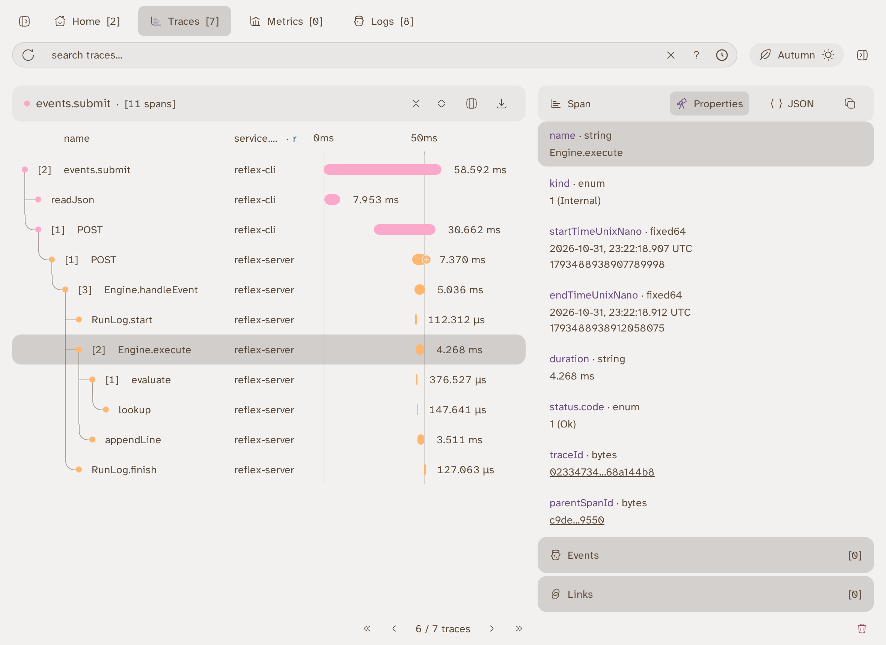
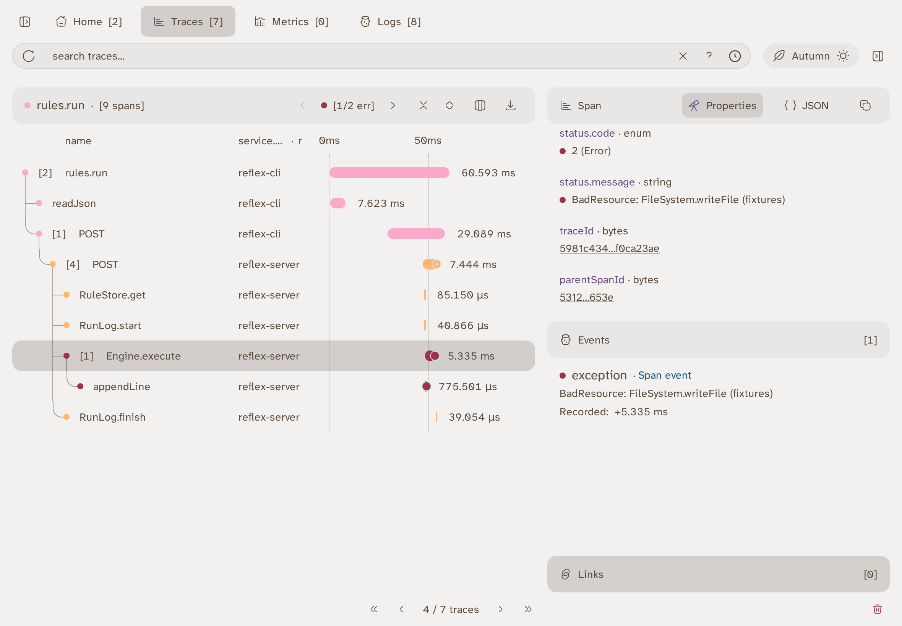
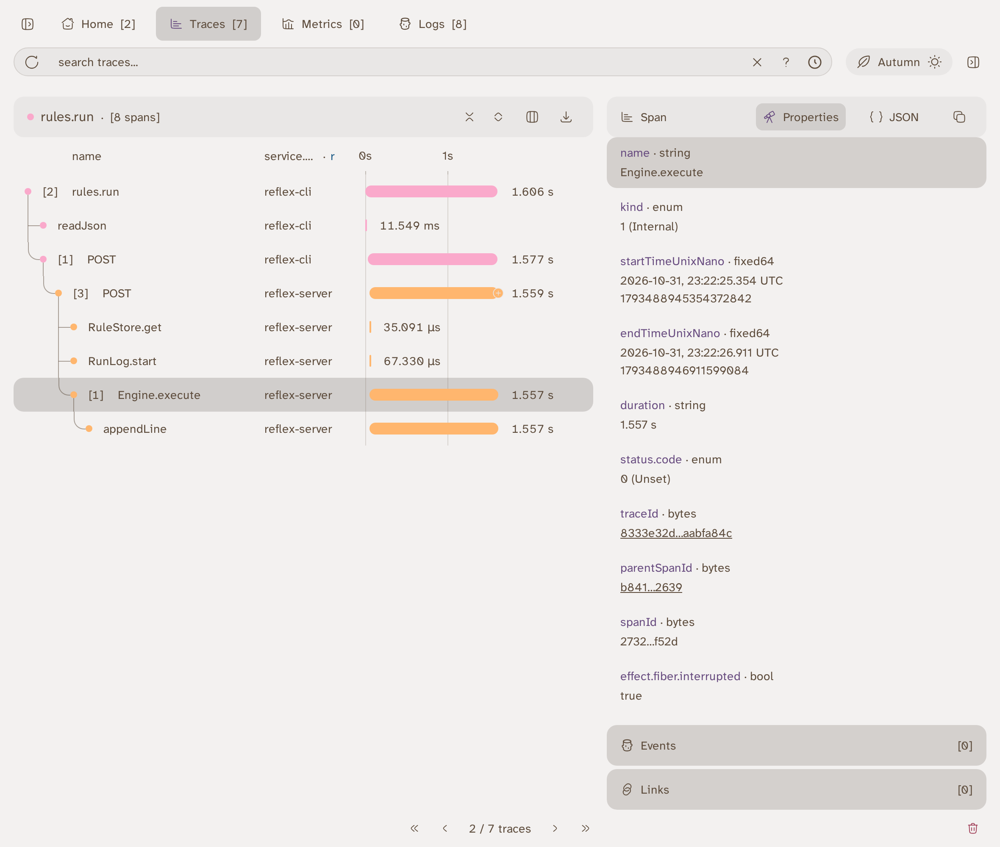

The course uses otel-desktop-viewer to inspect traces and logs locally.
Open its interface at [http://localhost:8000](http://localhost:8000). From
[Exporting traces with OtlpTracer](/learn/part-2/16-the-picture-you-already-know)
on, your programs send it spans and logs over OTLP on port 4318.

- `pnpm run doctor --viewer` downloads and starts it the first time.
- `pnpm viewer` starts it in later sessions.
- It keeps everything it receives until you stop it.

Use this page as a reference when a lesson asks you to inspect a span. The
screenshots show both a successful run and runs that failed or were
interrupted.

## Parts of a trace

A trace records a piece of work, such as a CLI command, an HTTP request or
an interval tick. It consists of spans arranged in a tree, so you can see
which operations ran inside others.

A span records the name and duration of an operation. Each call to a
function defined with `Effect.fn("name")` creates a span with that name.

The screenshot below shows the checkpoint from
[Exporting traces with OtlpTracer](/learn/part-2/16-the-picture-you-already-know).
The expense rule has been stored, and the CLI is submitting `laptop.json`
with `events.submit`.

## Parts of the screen

- The Traces tab lists traces by their root span, newest first. Select a
  trace to open it. You can hide this list with the sidebar toggle at the
  top left to make more room for the waterfall.
- The waterfall has one row per span, indented to show nesting. In the
  screenshot, `Engine.execute` ran inside `Engine.handleEvent`, which ran
  inside the server's `POST`. The number in brackets counts a span's children.
- Each bar shows when a span started and how long it took, using the time
  axis at the top. The colour identifies the service rather than the result:
  pink is `reflex-cli` and orange is `reflex-server`.
- Selecting a row opens the details panel on the right. It shows the span
  duration, `status.code` and attributes such as `rule.id`. Logs written
  inside the span appear under Events and in the Logs tab.

## Span status

A span created by Effect ends with the result of the effect it wraps. In
these course examples, you will see the following statuses:

| Result | `status.code` | Colour | Meaning                                                   |
| ------ | ------------- | ------ | --------------------------------------------------------- |
| Ok     | `1 (Ok)`      | none   | The effect succeeded.                                     |
| Error  | `2 (Error)`   | red    | The effect failed with a typed error or a defect.         |
| Unset  | `0 (Unset)`   | none   | The effect was interrupted before it succeeded or failed. |

### A failed span

Here, `rules run` executes a rule whose `appendFile` path is `fixtures`.
Because that path is a directory rather than a file, the write fails.

- The failed action's span and its enclosing execution span are red. The
  trace header counts the errors (`1/2 err`); use the arrows next to the
  count to move between them.
- `status.code` is `2 (Error)`. `status.message` and the `exception` event
  carry the error's message.
- The parent `POST` is not red. The engine turned the failure into a `failed`
  outcome, so the request itself succeeded. The run row says the same thing:
  `failed (io)`.

### An interrupted span

This trace was recorded after pressing Ctrl-C in the CLI while `rules run`
was waiting for an append that could not finish. When the client
disconnected, the server interrupted the request handler, including its
`Engine.execute` and `appendLine` effects.

- `status.code` is `0 (Unset)`. This is also the default code for a span
  whose status has not been set, so Unset alone does not identify an
  interruption or indicate success.
- `effect.fiber.interrupted` is `true`, identifying this as an interruption.
- The bar ends at the moment of interruption. The duration is how long the
  work ran before it was stopped.

Until [Running rules on a schedule with FiberMap](/learn/part-3/19-rules-on-a-clock),
the Engine does not finalize interrupted runs, so their rows remain
`started`. That lesson adds an `interrupted` outcome. Removing a rule during
a poll then produces an interrupted span like this one and a corresponding
`interrupted` row.

## What each lesson shows

| Lesson                                                                                               | Where                  | What to look for                                                                                                                    |
| ---------------------------------------------------------------------------------------------------- | ---------------------- | ----------------------------------------------------------------------------------------------------------------------------------- |
| Setup to [Calling the API with HttpApiClient](/learn/part-2/15-talk-to-it)                           | nothing yet            | The trace list is empty. Your program creates spans, but nothing sends them to the viewer yet.                                      |
| [Exporting traces with OtlpTracer](/learn/part-2/16-the-picture-you-already-know)                    | `reflex-cli` to server | One trace that starts in `reflex-cli` and continues into `reflex-server`, with `Engine.execute` under `Engine.handleEvent`.         |
| [Running background work with Effect.forkScoped](/learn/part-3/18-work-that-runs-until-told-to-stop) | Logs tab               | The log line from `Effect.onInterrupt` when you press Ctrl-C.                                                                       |
| [Running rules on a schedule with FiberMap](/learn/part-3/19-rules-on-a-clock)                       | `reflex-server`        | One trace per interval tick. `failed (status)` ticks are red. Removing a rule during a `/slow` poll leaves one Unset span.          |
| [Telling errors from defects with Cause](/learn/part-3/20-an-action-over-the-network)                | `reflex-server`        | Three red `Engine.execute` spans: a 500 status, a timeout, and the planted bug.                                                     |
| [Running work concurrently with Effect.forEach](/learn/part-3/21-many-at-once) and the diagnosis     | `reflex-server`        | Four `Engine.execute` spans under one `Engine.handleEvent`, starting together: two red, two Ok. The parent lasts about the timeout. |
| [Challenge: pausing and resuming rules](/learn/part-4/24-independent-challenge)                      | `reflex-server`        | Under the `mixed` scenario the paused rule has no `Engine.execute` span. After resume it has one.                                   |
