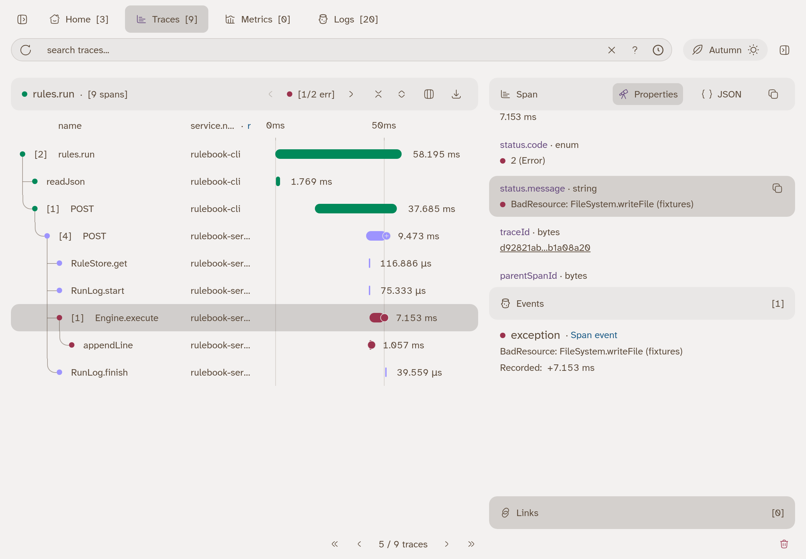
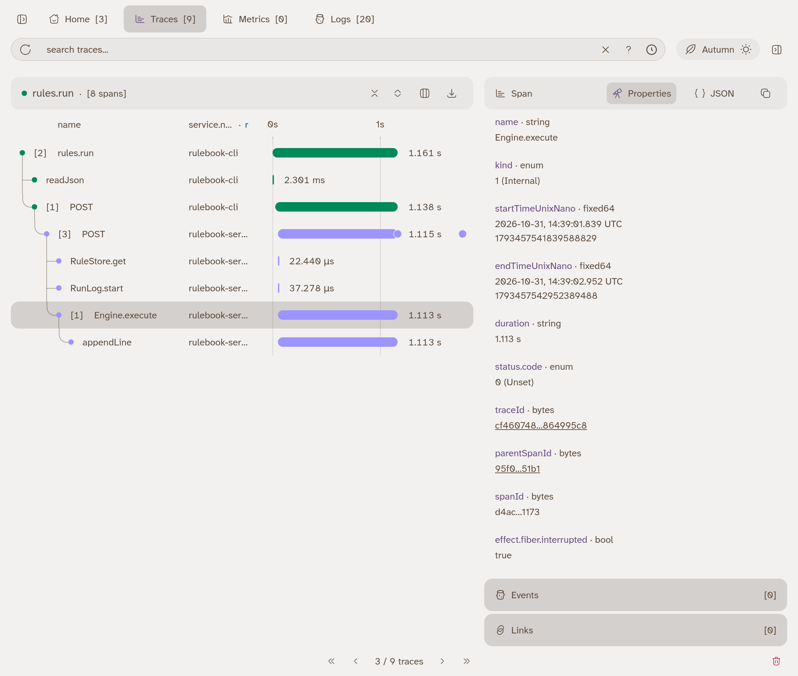

otel-desktop-viewer is the local version of the trace panel you used in the
playground. Your programs send it spans and logs over OTLP on port 4318, and
it shows them at [http://localhost:8000](http://localhost:8000).
`pnpm run doctor --viewer` starts it the first time, `pnpm viewer` after that.
It keeps what it receives until you stop it.

This page is a reference. Read it once now, and come back when a lesson says
to look at a span.

## A trace

A trace is one piece of work from start to end: one CLI command, one HTTP
request, one interval tick. It is a tree of spans. Each span is a named,
timed step, and every `Effect.fn("name")` you write is a span with that name.

The screenshot shows the lesson 16 checkpoint: `events.submit` from the CLI,
with the expense rule stored, submitting `laptop.json`.

- The Traces tab lists traces by their root span, newest first. Pick one to
  open it. The sidebar toggle at the top left hides the list and gives the
  waterfall more room.
- The waterfall has one row per span. Indentation is nesting: `Engine.execute`
  ran inside `Engine.handleEvent`, which ran inside the server's `POST`. The
  number in brackets is how many children a span has.
- The bar shows when the span started and how long it took, against the time
  axis at the top. Bar colour is the service, not the result: green is
  `rulebook-cli`, purple is `rulebook-server`.
- Select a row to see the span on the right: its duration, `status.code`, and
  attributes such as `rule.id`. Logs written inside a span are listed under
  Events and in the Logs tab.

## An Error span

A span ends with the result of the effect it wraps. When that effect fails, or
dies with a defect, the span's status is Error.

This is `rules run` against a rule whose `appendFile` path is `fixtures`, a
directory, so the write fails.

- The failed span and the span it failed inside are red, and the trace header
  counts the errors (`1/2 err`). The arrows next to the count step through
  them.
- `status.code` is `2 (Error)`. `status.message` and the `exception` event
  carry the error's message.
- The parent `POST` is not red. The engine turned the failure into a `failed`
  outcome, so the request itself succeeded. The run row says the same thing in
  its own words: `failed (io)`.

## An Unset span: interrupted

An interrupted effect did not fail and did not finish. It was stopped. Its span
ends with status Unset, which the viewer does not colour.

This one was made by pressing Ctrl-C on the CLI while `rules run` was waiting
on an append that could not finish. The server noticed the client was gone and
interrupted the handler, and with it `Engine.execute` and `appendLine`.

- `status.code` is `0 (Unset)`, the same code an ordinary span would have
  before anything set it. Do not read Unset as success.
- `effect.fiber.interrupted` is `true`. This attribute is how you tell an
  interruption apart.
- The bar ends at the moment of interruption, so the duration tells you how
  long the work ran before it was stopped.

Until lesson 19 nothing writes a terminal row for an interrupted run, so its
row stays `started`. Lesson 19 adds the `interrupted` outcome, and removing a
rule mid-poll produces exactly this picture.

## What to look for, lesson by lesson

| Lesson           | Where                    | What to look for                                                                                                                    |
| ---------------- | ------------------------ | ----------------------------------------------------------------------------------------------------------------------------------- |
| Setup            | `rulebook-lessons`       | Two `evaluateAll` traces from `pnpm tsx src/run-once.ts`, one per event.                                                            |
| 7 (local Part 1) | `rulebook-lessons`       | The malformed rule's `evaluate` span is red with the `SchemaError`; the log you added is listed under its Events.                   |
| 11 to 15         | nothing new              | Your Part 2 program does not export yet. The spans exist; nothing sends them until lesson 16.                                       |
| 16               | `rulebook-cli` to server | One trace that starts in `rulebook-cli` and continues into `rulebook-server`, with `Engine.execute` under `Engine.handleEvent`.     |
| 18               | Logs tab                 | The log line from `Effect.onInterrupt` when you press Ctrl-C.                                                                       |
| 19               | `rulebook-server`        | One trace per interval tick. `failed (status)` ticks are red. Removing a rule during a `/slow` poll leaves one Unset span.          |
| 20               | `rulebook-server`        | Three red `Engine.execute` spans: a 500 status, a timeout, and the planted bug.                                                     |
| 21 and 22        | `rulebook-server`        | Four `Engine.execute` spans under one `Engine.handleEvent`, starting together: two red, two Ok. The parent takes about the timeout. |
| 24               | `rulebook-server`        | Under the `mixed` scenario the paused rule has no `Engine.execute` span; after resume it has one.                                   |
