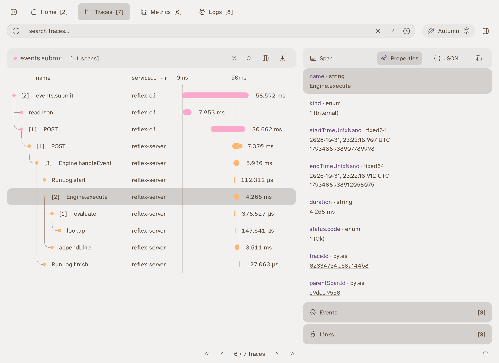

The named `Effect.fn` functions already create spans, including
`Engine.execute` and the CLI command handlers. You have seen their names
in failure reports, but have not yet exported the spans to the viewer.
Now that a command involves both the CLI and the server, a trace can help
you see which work happened in each process.

You will configure both programs to export spans and logs, then inspect
an `events.submit` trace in the local viewer. The Engine and handlers
already contain the instrumentation this needs; the change is in the
layers you provide at each entrypoint.

## Configure telemetry for each program

The starter's `src/Telemetry.ts` exports an unused placeholder `layer`
with the service name `reflex-lessons`. The viewer needs distinct service
names to distinguish server work from CLI work. Replace the file with
`layerServer` and `layerCli`, built by a shared helper:

<LessonCode file="checkpoints/16/src/Telemetry.ts" />

`OtlpTracer.layer` exports spans to
`http://localhost:4318/v1/traces`, while `OtlpLogger.layer` exports logs to
`http://localhost:4318/v1/logs`. Both attach a `resource` with a
`serviceName`: `reflex-server` for the server and `reflex-cli` for the CLI.

The helper provides their shared dependencies. `OtlpSerialization.layerJson`
encodes the OTLP data as JSON, and `FetchHttpClient.layer` supplies the HTTP
client used to send it.

Exporting telemetry adds some work to each run, and you need to keep the
viewer running to receive it. The earlier lessons still work without a
viewer because they do not provide these export layers.

## Provide the telemetry layers

In `src/server/main.ts`, provide `Telemetry.layerServer` at the bottom of
the server's layer stack. In `src/cli/main.ts`, provide `Telemetry.layerCli`
in the CLI's entrypoint pipeline. These layers configure telemetry for the
effects running in each program, so you do not need to change the Engine,
stores or handlers.

## Follow a command through both processes

Start the viewer with `pnpm viewer` if it is not running, and the server with
`pnpm dev:server`. In a second terminal:

```sh
pnpm cli rules add fixtures/rules/expense.json
pnpm cli events submit fixtures/events/laptop.json
```

Open [http://localhost:8000](http://localhost:8000) and pick the
`events.submit` trace. It starts in `reflex-cli` and continues into
`reflex-server`, with `Engine.execute` under `Engine.handleEvent`:



The CLI's `HttpClient` includes a `traceparent` header in the request with
the current trace and span ids. The server reads that header and starts its
request span as a child of the client span. This propagation allows the
viewer to show work from two processes in one trace. The HTTP client and
server provide it without additional code in your handlers.

Alongside the HTTP spans, the waterfall contains the functions you named
throughout the course:

- `Engine.handleEvent` and `Engine.execute` are the `Effect.fn` names from
  [Recording runs with Effect.onExit](/learn/part-2/12-an-engine-that-records).
- `evaluate` and `lookup` come from `Rule.ts`.
- `events.submit` and `rules.add` are the CLI handler names from the previous
  lesson.

[Reading a trace in the viewer](/learn/part-2/trace-viewer) describes each
part of this screen.

## Try it

An `Engine.execute` span already includes `rule.id` and `rule.trigger`.
Adding the condition result would help you distinguish a non-matching
event from a rule whose action ran, without opening the run history.

1. In `src/Engine.ts`, find where `Engine.execute` evaluates the condition.
   Store the result in a variable named `matched`.
2. Add `Effect.annotateCurrentSpan("rule.condition", matched)`. It adds the
   attribute to the span the code is running in.
3. Leave the other paths alone. A rule without a condition has nothing to
   record, and a missing field fails before there is a result.

Check your work with the server and the viewer running. Submitting
`fixtures/events/lunch.json` gives an `Engine.execute` span with
`rule.condition` set to `false`, and `laptop.json` gives one with `true`. The
hint and the changed file are in `exercises/16/`. The checkpoints do not
include this change, because nothing later depends on it.

## Checkpoint

With the viewer running, start the reference server for checkpoint 16:

```sh
pnpm checkpoint 16 server
```

In a second terminal:

```sh
pnpm checkpoint 16 cli rules add fixtures/rules/expense.json
pnpm checkpoint 16 cli events submit fixtures/events/laptop.json
```

The viewer shows one `events.submit` trace that starts in `reflex-cli` and
continues into `reflex-server`, with `Engine.execute` under
`Engine.handleEvent`, as in the screenshot above.

## Reference

| API                                      | What it does                                       | Introduced in                                                                |
| ---------------------------------------- | -------------------------------------------------- | ---------------------------------------------------------------------------- |
| `OtlpTracer.layer`                       | Exports spans over OTLP                            | this lesson                                                                  |
| `OtlpLogger.layer`                       | Exports logs over OTLP                             | this lesson                                                                  |
| `OtlpSerialization.layerJson`            | Encodes OTLP data as JSON                          | this lesson                                                                  |
| `resource: { serviceName }`              | Identifies the program that produced the telemetry | this lesson                                                                  |
| `traceparent`                            | Carries trace and span ids in an HTTP request      | this lesson                                                                  |
| `Effect.annotateCurrentSpan(key, value)` | Adds an attribute to the current span              | [Recording runs with Effect.onExit](/learn/part-2/12-an-engine-that-records) |
