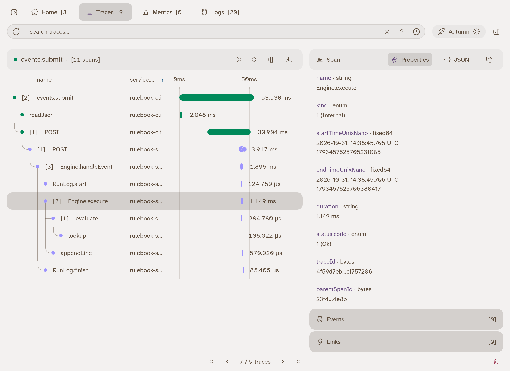

## The problem

In Part 1 the trace panel showed every `evaluate` as a span, because the
supplied telemetry layer was wired in for you. Since lesson 11 your program
has run without it. The spans are still created, `Engine.execute` included, and
nothing sends them anywhere. Now there are two programs, a CLI and a server,
and one command crosses both. That is exactly when a trace pays off.

## Write Telemetry.ts

Open `src/Telemetry.ts`. It is the file Part 1 hid, and it says
"You write this yourself in lesson 16". Replace it with a layer per program:

- `OtlpTracer.layer` exports spans to the viewer at
  `http://localhost:4318/v1/traces`.
- `OtlpLogger.layer` exports logs to `http://localhost:4318/v1/logs`.
- Both take a `resource` with a `serviceName`. Use `rulebook-server` for the
  server and `rulebook-cli` for the CLI, so the viewer tells them apart.
- They send JSON (`OtlpSerialization.layerJson`) over an `HttpClient`
  (`FetchHttpClient.layer`).

<LessonCode file="checkpoints/16/src/Telemetry.ts" />

Provide `Telemetry.layerServer` at the bottom of the server's layer stack in
`src/server/main.ts`, and `Telemetry.layerCli` in the CLI's run line. That is
all. Nothing in the Engine, the stores or the handlers changes.

## One trace, two processes

The CLI and the server are separate processes, and a trace still crosses
between them. The CLI's `HttpClient` adds a `traceparent` header to every
request with the current trace and span ids, and the server starts its request
span as a child of that span. That is propagation: the trace id travels with
the request, and the viewer stitches both halves into one tree. You did not
write any of it; both sides already speak the header.

## Revisit: the names you chose

Every row in the waterfall is a name you wrote. `Engine.handleEvent` and
`Engine.execute` are the `Effect.fn` names from lesson 12, `evaluate` and
`lookup` come from `Rule.ts` in lesson 11, and `events.submit` and `rules.add`
are the CLI handler names from lesson 15. Lesson 7 said the names you choose
are the span names you will read later. This is later.

## Exercise

The `Engine.execute` spans carry `rule.id` and `rule.trigger`, and nothing
says what the condition decided. In `src/Engine.ts`, give the result of
`evaluate` a name and add it to the span with
`Effect.annotateCurrentSpan("rule.condition", matched)`. A rule without a
condition has nothing to record, and a missing field fails before there is a
result.

Check: with the server and the viewer running, submitting
`fixtures/events/lunch.json` gives an `Engine.execute` span with
`rule.condition` set to `false`, and `laptop.json` one with `true`. The hint
and the changed file are in `exercises/16/`. The checkpoints do not include
it; nothing later depends on it.

## Now and later

What you need now: telemetry is one layer per program, provided at the edge,
and traces cross processes on their own. The cost is a little time per span
and a second running program, the viewer. Unpacked later: what the viewer
shows when a run fails, times out or is interrupted (lessons 19 and 20).

## Checkpoint

With the viewer running (`pnpm viewer`), start the checkpoint's server:

```sh
pnpm checkpoint 16 server
```

and in a second terminal:

```sh
pnpm checkpoint 16 cli rules add fixtures/rules/expense.json
pnpm checkpoint 16 cli events submit fixtures/events/laptop.json
```

Open [http://localhost:8000](http://localhost:8000) and pick the
`events.submit` trace. It starts in `rulebook-cli` and continues into
`rulebook-server`, with `Engine.execute` under `Engine.handleEvent`:



[The trace viewer](/learn/part-2/trace-viewer) explains each part of this
screen.

## Reference card

| API                                      | What it does                                              | Lesson |
| ---------------------------------------- | --------------------------------------------------------- | ------ |
| `OtlpTracer.layer`                       | Exports spans over OTLP                                   | 16     |
| `OtlpLogger.layer`                       | Exports logs over OTLP                                    | 16     |
| `OtlpSerialization.layerJson`            | Sends OTLP as JSON                                        | 16     |
| `resource: { serviceName }`              | Names the program in the viewer                           | 16     |
| `traceparent`                            | The header `HttpClient` uses to carry a trace to a server | 16     |
| `Effect.annotateCurrentSpan(key, value)` | Adds one attribute to the current span                    | 12     |
